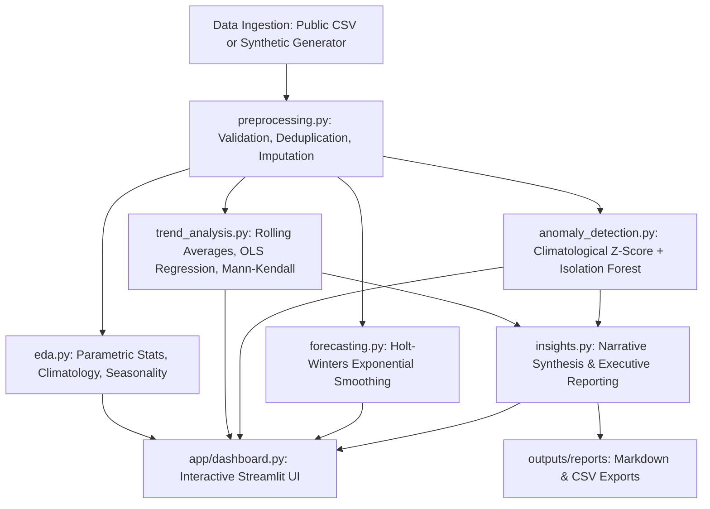

# Climate Trend Analyzer - Architecture & Methodology

## 1. System Overview

**Climate Trend Analyzer** is an end-to-end Python data science platform designed to model, clean, quantify, and visualize climatic variables across multi-decadal time spans.

---

## 2. Mathematical & Statistical Methods

### 2.1 Synthetic Climate Simulation
To provide a reproducible educational baseline without requiring external API tokens or massive climate downloads, `src/data_generator.py` implements a physics-informed time series:
1. **Long-Term Trend**: Linear warming component $\Delta T(t) = \beta \cdot t$, where $\beta$ defaults to $+0.28^\circ\text{C}/\text{decade}$.
2. **Annual Seasonality**: Harmonic sinusoidal oscillation:
   $$S(t) = A \cdot \sin\left(\frac{2\pi(t - \phi)}{365.25}\right)$$
   representing solar radiative insolation variations.
3. **Autoregressive Weather Memory**: Day-to-day / month-to-month persistence modeled via an AR(1) stochastic process:
   $$\epsilon_t = \phi \epsilon_{t-1} + w_t, \quad w_t \sim \mathcal{N}(0, \sigma^2)$$
4. **Precipitation Distribution**: Modeled using a two-parameter Gamma distribution $\Gamma(k, \theta)$ modulated by seasonal storm/monsoon indices.
5. **Coupled Humidity**: Physical negative coupling with dry heat and positive coupling with rainfall, bounded strictly within $[0\%, 100\%]$.

### 2.2 Trend Estimation & Statistical Inference
1. **Ordinary Least Squares (OLS)**:
   $$Y_t = \alpha + \beta t + \epsilon_t$$
   Computes slope $\beta$ ($^\circ\text{C}/\text{year}$ and $^\circ\text{C}/\text{decade}$), coefficient of determination $R^2$, standard error, and two-tailed Student's $t$-test $p$-value testing $H_0: \beta = 0$.
2. **Mann-Kendall Non-Parametric Monotonic Trend Test**:
   Evaluates rank correlation $\tau$ without assuming normal distribution or homoscedasticity of residuals.
3. **Rolling Baseline Filters**:
   12-month and 36-month moving averages dampening high-frequency noise to reveal multi-year cycles (e.g. ENSO-like variability).

### 2.3 Dual-Engine Anomaly Detection
1. **Climatological Z-Score**:
   Unlike a naive global standard deviation, temperature extremes depend strongly on the calendar month. For each month $m \in \{1, \dots, 12\}$:
   $$z_{i, m} = \frac{T_{i, m} - \mu_m}{\sigma_m}$$
   Values with $|z_{i, m}| \ge 2.5\sigma$ are flagged as seasonal heatwaves or cold snaps.
2. **Isolation Forest (Unsupervised Tree Ensemble)**:
   Isolates multivariate anomalies across $(T, \text{Rain}, \text{Humidity}, \sin(\text{month}), \cos(\text{month}))$ by measuring average path lengths in random decision trees. Shorter paths indicate higher outlier severity.
3. **Consensus Engine**:
   Offers configurable union or intersection consensus rules, tagging each event with plain-English rationales.

### 2.4 Time-Series Forecasting & Backtesting
- **Model**: Holt-Winters Exponential Smoothing with additive trend and additive annual seasonality.
- **Validation**: Holdout backtesting where the final 12 months are excluded from model training.
- **Metrics**: Mean Absolute Error (MAE), Root Mean Squared Error (RMSE), Mean Absolute Percentage Error (MAPE), and $R^2$.
- **Uncertainty Bounds**: $95\%$ prediction interval computed from residual variance: $\hat{y}_t \pm 1.96 \cdot \text{RMSE}$.

---

## 3. Scientific Integrity & Disclaimers

1. **Simulated vs. Measured Data**: All generated datasets include an `is_synthetic = True` flag and clear badges in the UI. Synthetic data must never be presented as actual station observations.
2. **Correlation vs. Causation**: Empirical trends in precipitation and temperature do not prove isolated causality.
3. **Forecasting Limitations**: Statistical extrapolations illustrate mathematical pattern continuation. They are not physical General Circulation Models (GCMs) forced with IPCC Shared Socioeconomic Pathways (SSPs).
